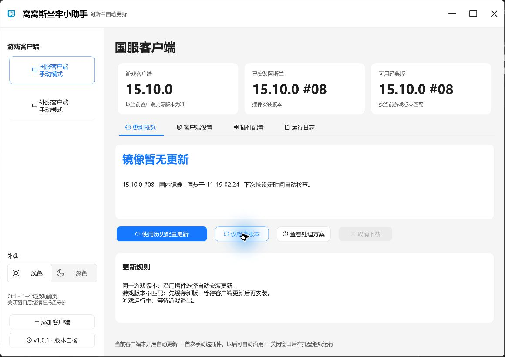
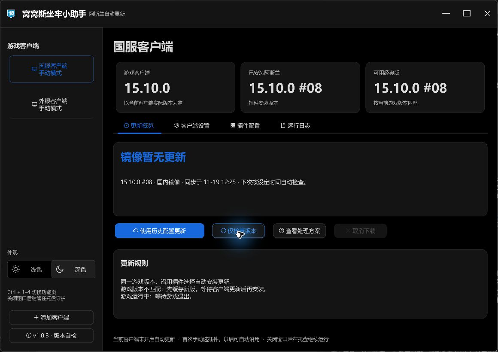

# 窝窝斯坐牢小助手


因为懒得每次手动更新阿斯兰，写了这个助手。

选一次插件，以后让它定期检查、下载并安装。国服、外服分开管理；也能直接导入群友的配置，省得对着截图挨个勾选。

**[下载 1.0.1 安装包](https://github.com/REREREGO/wows-aslain-assistant/releases/download/v1.0.1/AslainAssistant.Setup.1.0.1.exe)** · [更新说明](https://github.com/REREREGO/wows-aslain-assistant/releases/tag/v1.0.1) · [反馈问题](https://github.com/REREREGO/wows-aslain-assistant/issues)

适用于 Windows，需要 .NET Framework 4.8。更新的是阿斯兰**经典模组包**。



## 第一次用

1. 运行安装包，安装后从桌面快捷方式打开。
2. 左侧选客户端，到 **客户端设置** 选择游戏目录，选到包含 `WorldOfWarships.exe` 的那一层。也可以试试 **自动发现**。
3. 已经装过阿斯兰，就在 **插件配置** 点 **读取已装配置**。第一次装，点 **选择插件 / 重装**，在阿斯兰安装器里选好插件。
4. 想让助手以后自己更新，到 **客户端设置** 开启 **自动下载并更新此客户端**，再按需要设置检查间隔和开机启动。

点关闭后，助手会留在托盘运行。单击托盘图标打开窗口；右键选 **退出助手** 才会完全退出。

有多个客户端就点 **添加客户端**，分别设置目录和插件。不要的客户端可以在设置里删除，游戏和模组不会被删掉。

## 直接抄群友的配置

让群友在 **插件配置 → 导出配置** 发你一份 JSON 或 INF；阿斯兰导出的 REG 也支持。

你选好自己的客户端，点 **导入配置**，然后点同一页的 **使用该配置更新**。哪怕阿斯兰已经是最新版，也会按这份新配置重新安装。


装好后，这份选择就会成为后续自动更新使用的配置。导入时会暂停该客户端的自动更新，确认效果后再打开。

| 按钮 | 用哪份配置 |
| --- | --- |
| **使用该配置更新** | 刚导入、还没应用的预设；安装成功后按钮消失 |
| **使用历史配置更新** | 上次安装成功的配置；后台自动更新也用这一份 |

分享的是插件选择，不是整个模组文件夹。助手会保留你的游戏目录。国服和外服更新进度可能不同，尽量找相同游戏版本的配置。

## 更新时会发生什么

- **游戏开着**：手动安装会提醒你退出游戏后重试，后台更新会等待。助手不会替你关闭游戏。
- **模组包比游戏版本新**：先下载，等游戏更新到对应版本再安装。
- **网络断了**：保留现有模组和配置；开启自动更新时，约 15 分钟后重试。

1.0.1 支持国内查询和下载：版本信息从 [Gitee](https://gitee.com/rererergo/aslain_versions) 读取，安装包从 [GitCode](https://gitcode.com/REREREGO/aslain_versions/releases) 下载，失败时再尝试官网。

**客户端设置 → 国内镜像** 还有蓝奏云备用入口，提取码 `6fpw`。手动下载后，点 **导入已下载的安装包**，校验通过就能用于安装。

阿斯兰安装器中的部分插件仍需连接它自己的下载服务器，所以拿到安装包不代表所有插件都能离线安装。

## 助手自己的版本

左下角显示当前版本。点 **版本自检**，就能查看 GitHub 已发布的版本和检查结果；这一步不会直接安装。发现新版后，再点 **下载并安装助手新版**。

想全自动接收助手更新，在 **客户端设置** 开启 **自动接收助手新版**。关闭后仍会定期检查，由你决定是否安装。覆盖安装会退出旧助手，保留客户端和插件配置。

左下角也可以切换深浅主题，重启后会记住。



## 装完发现少了插件

先点 **查看处理方案**。助手会根据安装日志列出能找到的资源下载地址、文件名和缓存目录。按提示补好文件后重装，别勾选清空下载缓存。

仍然有问题，可以到 [Issues](https://github.com/REREREGO/wows-aslain-assistant/issues) 发截图和运行日志，附上助手版本、游戏版本、阿斯兰版本及区服。

<details>
<summary>给想自己编译或修改的开发者</summary>

普通玩家下载安装包即可，不需要运行下面的命令。

项目使用 C# / .NET Framework 4.8 / WinForms，界面统一使用 AntdUI 2.4.19。在 Windows PowerShell 中运行：

```powershell
.\build.ps1 -OutputDirectory build
```

[发布说明](docs/RELEASING.md) · [国内镜像维护](docs/MIRRORS.md) · [AntdUI 许可证](vendor/AntdUI/2.4.19/LICENSE.txt)

</details>

个人制作的非官方工具，阿斯兰模组包来自 [Aslain](https://aslain.com/)。made with GPT 6 Astra。

## 版本下载

从 1.0.1 开始记录，包含最新及后续历史版本，暂不限制保留数量。

| 版本 | 主要变化 | 安装包 |
| --- | --- | --- |
| **1.0.1（最新）** | 国内版本源与下载镜像、助手版本自检 | [下载](https://github.com/REREREGO/wows-aslain-assistant/releases/download/v1.0.1/AslainAssistant.Setup.1.0.1.exe) |

[查看全部发行记录](https://github.com/REREREGO/wows-aslain-assistant/releases)
