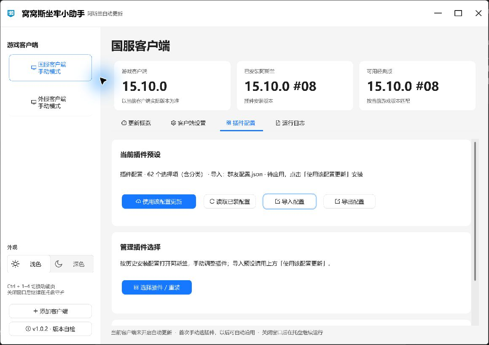

# 窝窝斯坐牢小助手


因为懒得每次手动更新阿斯兰，写了这个助手。

选一次插件，以后让它定期检查、下载并安装。国服、外服分开管理；也能直接导入群友的配置，省得对着截图挨个勾选。

**[下载 1.0.3 安装包](https://github.com/REREREGO/wows-aslain-assistant/releases/download/v1.0.3/AslainAssistant.Setup.1.0.3.exe)** · [更新说明](https://github.com/REREREGO/wows-aslain-assistant/releases/tag/v1.0.3) · [反馈问题](https://github.com/REREREGO/wows-aslain-assistant/issues)

适用于 Windows，需要 .NET Framework 4.8。更新的是阿斯兰**经典模组包**。


## 第一次用

1. 运行安装包，安装后从桌面快捷方式打开。
2. 左侧选客户端，到 **客户端设置** 选择游戏目录，选到包含 `WorldOfWarships.exe` 的那一层。也可以试试 **自动发现**。
3. 已经装过阿斯兰，就在 **插件配置** 点 **读取已装配置**。第一次装，点 **选择插件 / 重装**，在阿斯兰安装器里选好插件。
4. 想让助手以后自己更新，到 **客户端设置** 开启 **自动下载并更新此客户端**，再按需要设置检查间隔和开机启动。

点关闭后，助手会留在托盘运行。单击托盘图标打开窗口；右键选 **退出助手** 才会完全退出。

有多个客户端就点 **添加客户端**，分别设置目录和插件。不要的客户端可以在设置里删除，游戏和模组不会被删掉。

## 直接抄群友的配置

让群友在 **插件配置 → 导出配置** 发你一份 JSON 或 INF；阿斯兰导出的 REG 也支持。

你选好自己的客户端，点 **导入配置**，然后点同一页的 **使用该配置更新**。哪怕阿斯兰已经是最新版，也会按这份新配置重新安装。



装好后，这份选择就会成为后续自动更新使用的配置。导入时会暂停该客户端的自动更新，确认效果后再打开。

| 按钮 | 用哪份配置 |
| --- | --- |
| **使用该配置更新** | 刚导入、还没应用的预设；安装成功后按钮消失 |
| **使用历史配置更新** | 上次安装成功的配置；后台自动更新也用这一份 |

分享的是插件选择，不是整个模组文件夹。助手会保留你的游戏目录。国服和外服更新进度可能不同，尽量找相同游戏版本的配置。

## 更新时会发生什么

- **游戏开着**：手动安装会提醒你退出游戏后重试，后台更新会等待。助手不会替你关闭游戏。
- **模组包比游戏版本新**：先下载，等游戏更新到对应版本再安装。
- **网络断了**：保留现有模组和配置；开启自动更新时，约 15 分钟后重试。

## 国内、国外怎么查版本和下载

下面两条路线用于更新**阿斯兰模组包**。助手自身的安装包和版本自检仍走本仓库的 [GitHub 发行版](https://github.com/REREREGO/wows-aslain-assistant/releases)。

| 路线 | 在哪里查版本 | 从哪里下载安装包 |
| --- | --- | --- |
| **国内镜像（默认）** | [Gitee 版本清单仓库](https://gitee.com/rererergo/aslain_versions)，依次尝试原始文件和公开 API | [GitCode 发行版](https://gitcode.com/REREREGO/aslain_versions/releases)，提供官网原始 `.exe` |
| **国外官网直连** | [Aslain 经典版发布帖](https://aslain.com/index.php?/topic/2020-download-%E2%98%85-world-of-warships-%E2%98%85-modpack/) | 发布帖中的安装包，助手从 `filez.aslain.com` 下载 |

所有地区默认都按“国内优先、官网备用”的顺序访问：国内清单不可用时改查官网；GitCode 下载失败时尝试官网下载安装包。国内清单读取成功，就以镜像已同步的版本为准。Gitee 的两个查询入口属于同一个平台。

海外用户或能稳定访问官网的用户，可以到 **客户端设置 → 国内镜像 → 版本源设置**，清空地址并保存，之后直接查官网、从官网下载。这项来源设置对所有客户端生效。

手工下载备用：[蓝奏云目录](https://wwbcm.lanzouq.com/b01i60xlde)，提取码 `6fpw`；软件里的 **客户端设置 → 国内镜像 → 蓝奏云下载** 也能打开。先点 **仅检查版本**，再下载相同版本的 `.exe`，点 **导入已下载的安装包**，校验通过就能用于安装。蓝奏云由维护者手工补包，是否已有所需版本以目录为准。

阿斯兰安装器中的部分插件仍需连接它自己的下载服务器，所以拿到安装包不代表所有插件都能离线安装。

### 预计最多要等多久

从官网发布**与你的游戏版本匹配**的安装包开始，按默认每小时检查、助手持续在线且空闲、云端任务按时启动并一次同步成功估算：

| 路线 | 安装包在该来源可用 | 助手自动发现新版的保守预估 |
| --- | --- | --- |
| 官网直连 | 无需等待镜像同步 | 约 **1 小时**，另加查询耗时 |
| 国内镜像 | 约 **1 小时 35 分钟以内** | 约 **2 小时 35 分钟**，另加查询耗时 |

国内同步任务设为每小时第 17 分钟检查官网，单次任务限时 35 分钟，因此按“等下一轮最多 60 分钟 + 同步预留 35 分钟 + 助手默认检查间隔 60 分钟”计算。若你改了检查间隔，就把最后的 60 分钟换成自己的设置。点 **仅检查版本** 或 **使用历史配置更新** 可以立即检查，省去本地等下一轮的时间。

**这是正常运行时的预估，不是保证的最高延迟。** [GitHub 定时任务可能排队延迟或被跳过](https://docs.github.com/en/actions/reference/workflows-and-actions/events-that-trigger-workflows#schedule)，同步失败还需等后续重试；断网、助手退出、其他客户端正在安装等情况也会延后。上表不包含下载安装时间，游戏运行中仍会等待你退出后再安装。

单次查询和下载遇到卡顿时，助手按以下时间换源或报错：

- **查版本**：每个国内入口限时 8 秒，官网限时 45 秒。默认两个国内入口全部超时、再尝试官网，按超时设置合计约 **61 秒**；仅官网约 **45 秒**。这与上面的新版同步延迟是两回事。
- **下载安装包**：每个来源连接等待 15 秒，连续 30 秒收不到数据会中止该次尝试，单个来源总时限 30 分钟；失败后尝试下一来源。下载速度取决于网络，这些是失败退出的时限，不代表一定能在时限内下载完成。

## 助手自己的版本

左下角显示当前版本。点 **版本自检**，就能查看 GitHub 已发布的版本和检查结果；这一步不会直接安装。发现新版后，再点 **下载并安装助手新版**。

想全自动接收助手更新，在 **客户端设置** 开启 **自动接收助手新版**。关闭后仍会定期检查，由你决定是否安装。覆盖安装会退出旧助手，保留客户端和插件配置。

左下角也可以切换深浅主题，重启后会记住。


## 装完发现少了插件

先点 **查看处理方案**。助手会根据安装日志列出能找到的资源下载地址、文件名和缓存目录。按提示补好文件后重装，别勾选清空下载缓存。

仍然有问题，可以到 [Issues](https://github.com/REREREGO/wows-aslain-assistant/issues) 发截图和运行日志，附上助手版本、游戏版本、阿斯兰版本及区服。

<details>
<summary>给想自己编译或修改的开发者</summary>

普通玩家下载安装包即可，不需要运行下面的命令。

项目使用 C# / .NET Framework 4.8 / WinForms，界面统一使用 AntdUI 2.4.19。在 Windows PowerShell 中运行：

```powershell
.\build.ps1 -OutputDirectory build
```

[发布说明](docs/RELEASING.md) · [测试说明](docs/TESTING.md) · [国内镜像维护](docs/MIRRORS.md) · [AntdUI 许可证](vendor/AntdUI/2.4.19/LICENSE.txt)

</details>

## 免责声明

这是个人制作、免费提供的非官方工具，与 Aslain、《战舰世界》的开发商和运营方没有官方关联，不代表其授权、认证或推荐。

阿斯兰模组包来自 [Aslain](https://aslain.com/)，国内镜像提供官网原始安装包。模组、图片、商标及第三方组件的权利归各自作者或权利人所有，使用要求以相应许可为准；本项目不授予这些内容的额外使用或再分发权利。

助手和镜像按现状提供，不保证持续可用、及时同步或适配所有区服与游戏版本。文件哈希和更新签名用于校验来源及完整性，不是安全认证，也不保证插件效果或账号安全。请自行判断是否使用插件，遵守所在区服的游戏规则，并备份重要配置。

助手和镜像的问题请到 [Issues](https://github.com/REREREGO/wows-aslain-assistant/issues) 反馈；模组本身的问题可查阅 Aslain 官网及论坛。如果你是相关内容的作者或权利人，认为镜像分发不符合你的许可要求，也请附上文件链接和权利说明，维护者核实后会及时下架或停止同步。

made with GPT 6 Astra。

## 版本下载

从 1.0.1 开始记录，包含最新及后续历史版本，暂不限制保留数量。

| 版本 | 主要变化 | 安装包 |
| --- | --- | --- |
| **1.0.3（最新）** | 修复客户端设置、插件配置滚动残影 | [下载](https://github.com/REREREGO/wows-aslain-assistant/releases/download/v1.0.3/AslainAssistant.Setup.1.0.3.exe) |
| 1.0.2 | 修复助手下载卡住时取消不生效，统一下载超时处理 | [下载](https://github.com/REREREGO/wows-aslain-assistant/releases/download/v1.0.2/AslainAssistant.Setup.1.0.2.exe) |
| 1.0.1 | 国内版本源与下载镜像、助手版本自检 | [下载](https://github.com/REREREGO/wows-aslain-assistant/releases/download/v1.0.1/AslainAssistant.Setup.1.0.1.exe) |

[查看全部发行记录](https://github.com/REREREGO/wows-aslain-assistant/releases)
