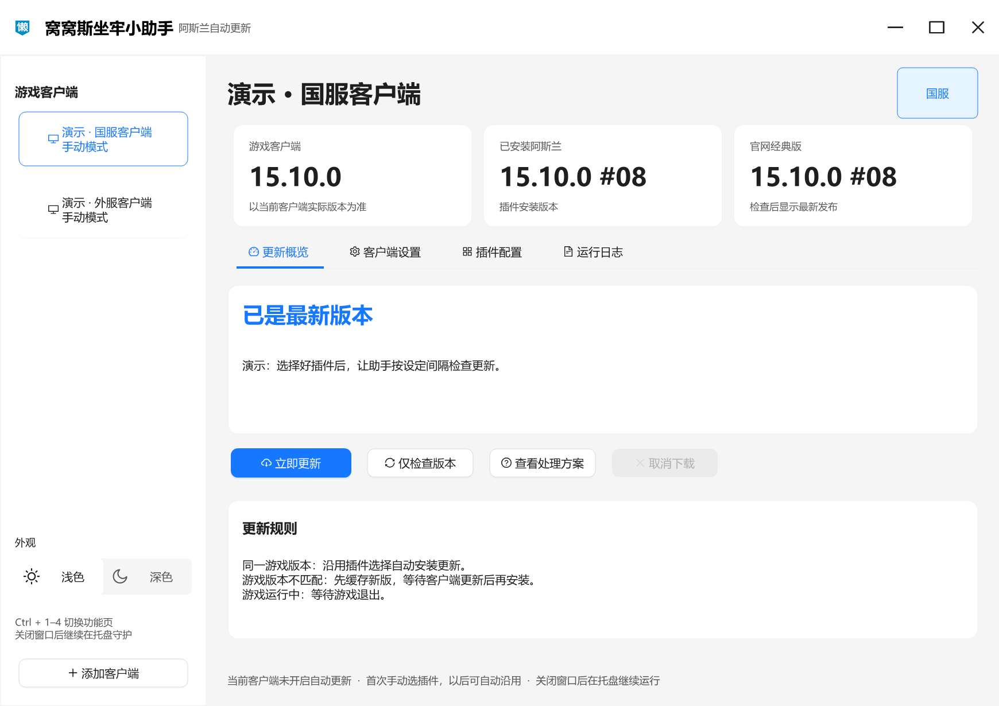
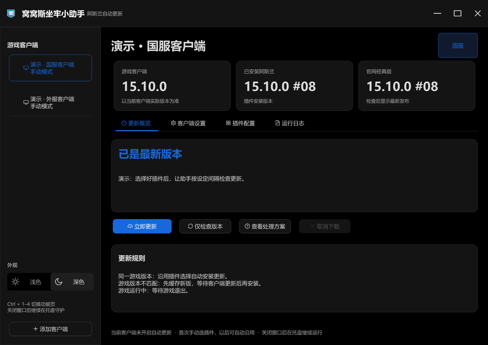
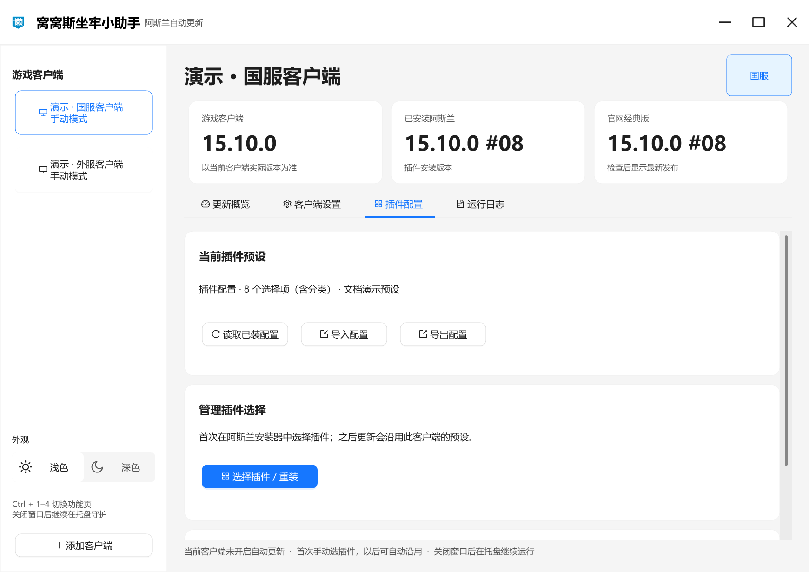

# 窝窝斯坐牢小助手


**起因很简单：我懒得手动更新阿斯兰。**

每次战舰世界或阿斯兰更新，都要找版本、下载安装包、确认游戏目录，再把选过的插件装一遍。既然这些步骤大多重复，那就让一个小助手替我盯着。

这个 Windows 桌面工具会定期检查 Aslain 战舰世界经典模组包，在游戏版本匹配时，沿用你保存的插件选择更新。国服和外服可以分别管理，也可以添加多个安装路径。

[下载最新安装包](https://github.com/REREREGO/wows-aslain-assistant/releases/latest/download/AslainAssistant.Setup.exe) · [所有版本](https://github.com/REREREGO/wows-aslain-assistant/releases) · [反馈问题](https://github.com/REREREGO/wows-aslain-assistant/issues) · [阿斯兰官网](https://aslain.com/)

## 界面预览

以下截图使用演示客户端与预设，不包含真实玩家配置。





## 第一次使用

1. 下载并运行 **AslainAssistant.Setup.exe**。安装器默认创建桌面快捷方式，也可以选择安装完成后启动助手。
2. 左侧选择“国服客户端”或“外服客户端”。如果有更多客户端，点左下角的 **添加客户端**。
3. 打开 **客户端设置**，点 **选择游戏目录** 或 **自动发现**。选择包含 `WorldOfWarships.exe` 和 `bin` 文件夹的游戏根目录。
4. 如果已经装过阿斯兰，助手会尝试读取现有插件选择；也可以到 **插件配置 → 读取已装配置** 手动读取。
5. 首次没有插件预设时，点 **立即更新**，在阿斯兰安装器里手动选一次插件。安装完成并核验后，助手会保存这份选择。
6. 回到 **客户端设置**，开启 **自动下载并更新此客户端**，设置检查间隔（1–24 小时）。需要开机守护时，再开启 **开机登录后启动助手**。

以后保持助手在托盘运行即可。阿斯兰安装本身可能需要 Windows 管理员授权。

## 四个页面怎么用

| 页面 | 可以做什么 |
| --- | --- |
| 更新概览 | 查看游戏版本、已装阿斯兰版本和官网版本；立即更新、仅检查版本、重试安装、查看处理方案。 |
| 客户端设置 | 设置游戏路径、检查间隔和自动更新；编辑客户端名称与类型；设置开机自启及助手自身更新。 |
| 插件配置 | 读取、导入、导出插件预设；打开阿斯兰安装器重新选择插件。 |
| 运行日志 | 查看检查、下载、安装核验的结果；打开日志目录和故障处理方案。 |

点击页面标签即可切换，也可以用 **Ctrl + 1 / 2 / 3 / 4**。助手会记住上次打开的页面。

### 多客户端：国服、外服、多套路径

国服和外服是不同客户端，不能只用“服务器地区”替代实际的游戏路径。每个客户端独立保存：

- 游戏根目录。
- 插件选择与安装预设。
- 自动更新开关和检查间隔。
- 安装结果、待处理异常和检查状态。

外服不强制拆成亚服、欧服、美服；按自己实际安装的客户端添加即可。同一个路径不能由两个配置同时管理，最多管理 20 个客户端。

### 自动更新会不会把新模组装到旧客户端里？

助手会先比较**游戏版本**：

| 当前情况 | 助手行为 |
| --- | --- |
| 游戏版本匹配，阿斯兰有新修订版 | 沿用当前客户端的插件选择更新。 |
| 官网模组包对应更高的游戏版本 | 可以先下载缓存，等待这个游戏客户端更新后再安装。 |
| 无法确认游戏版本 | 暂停安装，提示先用游戏启动器完成更新。 |
| 游戏正在运行 | 等待退出后再检查；下载完成后也会再次确认游戏是否运行。 |
| 同一个版本上次安装失败 | 保留错误提示，等待手动重试，不会无限循环安装。 |

**安装器退出不等于所有模组都装好了。** 助手还会读取安装日志，识别解压失败、缺失模组和插件脚本异常。

### 导入和导出配置



在 **插件配置** 页面使用：

- **读取已装配置**：从当前游戏目录读取阿斯兰保存的选择。
- **导入配置**：支持助手的 JSON 备份、阿斯兰 INF 和 REG。REG 只读取允许的配置字段，不会导入 Windows 注册表。
- **导出配置**：可以导出助手 JSON 配置或阿斯兰 INF 插件选择。
- **选择插件 / 重装**：打开阿斯兰安装器，修改当前客户端的插件选择。

导入后，助手会保留本机当前客户端的目录，并暂停该客户端的自动更新。确认配置后再开启，避免另一台电脑的路径或预设被直接执行。原配置会保留 `.bak` 备份。

### 深色、浅色和托盘

- 左下角 **外观** 可切换浅色 / 深色，所有功能页和应用弹窗一起切换。
- 主题和最后打开的页面会保存，重新启动后继续使用。
- 点窗口右上角关闭，会收起到系统托盘，继续按设定检查。
- 双击托盘图标重新打开；完整退出请使用托盘菜单的 **退出助手**。
- 同一 Windows 用户只运行一个助手；再次打开会唤起已有窗口，不会因不同快捷方式或配置路径启动一堆实例。
- 正在安装阿斯兰时，助手会等待安装结束，避免中途退出丢失安装结果。

## 助手自己怎么更新？

从 **1.4 版**开始，助手支持自身更新：

1. **客户端设置 → 助手更新** 中开启 **自动接收助手新版**（默认开启）。
2. 运行后开始检查，之后约每 6 小时检查一次；也可点 **检查助手更新** 立即检查。
3. 从本仓库发布源获取版本信息，校验发布签名，下载后继续核验 SHA-256、大小和安装包产品版本。
4. 游戏或模组安装还在运行时，先保留已下载的新助手，等待结束。
5. 新安装器自动通知旧助手退出，替换文件，更新完成后重新在托盘运行。

手动下载新版安装包也可以直接覆盖更新，不必先从托盘退出。若旧助手正在安装游戏模组，安装器会等待；文件替换失败时会尝试恢复旧文件。

游戏目录、插件预设、自动检查、主题和自启设置都会保留。第一次从没有自更新功能的旧版升级到 1.4，需要手动运行一次新安装包。

## 网络、下载源和断网行为

### 阿斯兰是否需要“外网”？

检查和下载需要互联网连接，当前使用：

| 用途 | 来源 |
| --- | --- |
| 阿斯兰版本、经典版直链与校验值 | `aslain.com` 的官方下载帖 |
| 阿斯兰经典版安装包 | `filez.aslain.com` |
| 阿斯兰安装器按插件选择下载的部分资源包 | `repo.aslain.com` |
| 本助手的新版安装包 | 本仓库 GitHub Releases |
| 本助手的备用版本信息 | 本仓库 `raw.githubusercontent.com` 地址 |

**需要访问这些站点，不代表一定要开代理。** 能否直连以及速度取决于你的网络。按 2026-11-18 核对的官方页面，未列出可确认的国内阿斯兰镜像，因此没有把不明来源网盘或搬运包设为自动安装源。

助手自身的两处版本信息地址都在 GitHub 基础设施上，**不是国内镜像**。备用地址同样必须通过内置公钥验签；它不能保证在所有国内网络下可用。

### 没有网络会怎样？

- 已安装的助手、模组和已保存的配置不会因为断网被清理。
- 无法连接时显示“等待网络恢复”，不会把网络错误当成安装成功。
- 开启自动更新的客户端约 15 分钟后重试；Windows 检测到网络重新连接时会提前复查。
- 手动模式需要恢复网络后再点检查 / 更新。
- 下载不完整的文件不会执行；完整缓存仍需通过校验才能复用。
- 已经校验并缓存的助手自身安装包，可在条件允许时继续安装，因为安装器包含助手所需文件。

阿斯兰的安装器还可能需要下载额外资源，因此“EXE 已下载”不代表所有模组都能离线安装。完全断网时，也无法确认阿斯兰官网是否又发布了更新。

## 遇到报错怎么办？

先点 **查看处理方案**。如果识别到资源包解压失败，窗口会列出：

1. 具体缺失的 `.7z` 文件名。
2. 从该次安装日志核对出的官方下载链接。
3. 当前客户端对应的 `Aslain_Modpack\DL_cache` 目录。
4. 重新安装时需要注意的步骤。

按方案下载完整的压缩包，保持文件名，放到提示的缓存目录，不要自行解压。重新运行阿斯兰时，不要勾选清空下载缓存，否则刚补好的文件也会被删除。

没有可靠下载链接时，助手会明确说明，不会猜一个地址。录像相关脚本返回非零退出码时，也会核对实际生效的游戏配置；设置已正确生效的情况不再误报为安装失败。

反馈问题时，建议说明助手版本、游戏客户端类型、游戏与阿斯兰版本、错误时间，以及相关日志片段。截图或日志发出前可以隐藏自己的用户名、私人目录等信息。

## 文件保存在哪里？

| 内容 | 位置 |
| --- | --- |
| 助手程序 | `%LOCALAPPDATA%\Programs\WoWS-Aslain-Assistant` |
| 用户数据 | `%LOCALAPPDATA%\WoWS-Aslain-Assistant` |
| 各客户端配置 | 用户数据目录下的 `profiles` |
| 主题与页面选择 | `ui.json` |
| 助手自身更新设置 | `assistant-update.json` |
| 日常日志 / 安装器日志 | `logs` / `setup.log` |

卸载助手会保留游戏、模组和客户端配置。便携运行时，`AslainAssistant.exe` 与 `AntdUI.dll` 必须在同一目录；单个 Setup 安装包已内嵌依赖。

## 构建与维护

技术栈：C#、.NET Framework 4.8、WinForms、**AntdUI 2.4.19**。主界面、弹窗及安装器统一使用组件库；文件对话框和托盘使用 Windows 原生接口。

在 Windows PowerShell 中执行：

```powershell
.\build.ps1 -OutputDirectory build
.\build\AslainAssistant.Tests.exe
.\build\AslainAssistant.UiTests.exe
```

业务测试模拟下载和安装；界面测试使用隔离配置，不执行真实游戏模组安装。界面已在 150% 缩放下核对，包含最小窗口、深浅主题和配置隔离检查。

退出正在使用的助手后，可另行运行 `build\AslainAssistant.InstanceTests.exe`，验证多个启动请求只保留一个进程，以及安装器使用的退出协议。它只使用独立测试配置，测试结束后退出自己创建的后台实例。

发布信息通过 `tools/Sign-Release.ps1` 签名。私钥保存在维护者本机的独立发布目录，**不能提交进仓库**。仓库只包含验证公钥；丢失或更换私钥会影响已有客户端对更新的信任。发布脚本及签名流程见 [发布说明](docs/RELEASING.md)。

AntdUI 使用 Apache-2.0 许可，见 [依赖许可](vendor/AntdUI/2.4.19/LICENSE.txt)。本项目是个人制作的非官方辅助工具，与 Wargaming、360 和 Aslain 没有从属关系。
